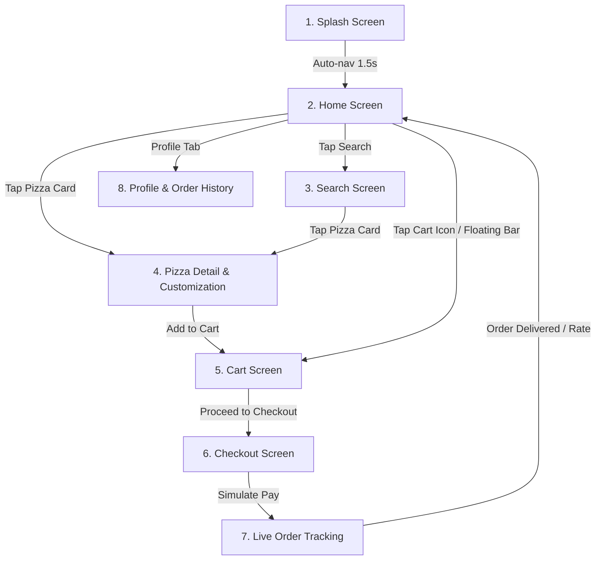

# Pizza 5 P's — UI Design Specification & Android Implementation Plan

A comprehensive, production-grade UI design specification and implementation roadmap for **Pizza 5 P's**, a single-brand Android pizza ordering application built with **Kotlin** and **Jetpack Compose (Material 3)**.

Designed specifically for an Android college project to showcase **commercial-grade UI polish, smooth state animations, and an end-to-end simulated ordering & delivery tracking flow** without backend complexity.

---

## User Review Required

> [!IMPORTANT]
> **Key Architectural Decisions for Review:**
> 1. **Project Location**: The Android project will be scaffolded in the user scratch directory at:
>    `/Users/maheepsinghsaluja/.gemini/antigravity/scratch/Pizza5Ps`
>    You can open this directory directly in Android Studio.
> 2. **Jetpack Compose + Material 3**: We will use 100% modern declarative Compose with Material 3 styling, dynamic color theming based on the warm Italian pizzeria palette (`#D62828` Tomato Red, `#FFF8F0` Warm Cream, `#1C1C1C` Charcoal).
> 3. **Interactive Demo Mode for Tracking**: The Order Tracking screen features an automatic timer progression (0s Confirmed → 5s Preparing → 10s Out for Delivery → 15s Delivered 🎉) plus manual step buttons so you can seamlessly demonstrate it to professors and evaluators.

---

## Open Questions

> [!NOTE]
> 1. **Image Assets**: Should we bundle high-res local pizza drawables (SVG/vectors & royalty-free web assets loaded via Coil with instant offline fallbacks) so the app works 100% offline without needing an active internet connection during college demos? *(Recommended: Yes, offline-first with bundled resources).*
> 2. **Navigation Style**: Would you prefer the Pizza Detail / Customization view as a dedicated full screen or an expandable modal bottom sheet over the Home screen? *(Recommended: Dedicated full screen with smooth shared transition feel, matching the PRD screen flow).*

---

## Visual Design Specification

### 1. Brand Color System (Pizzeria Theme)

| Token Name | Hex Code | Compose Color Name | Purpose / Usage |
| :--- | :--- | :--- | :--- |
| **Tomato Red (Primary)** | `#D62828` | `TomatoRed` | Primary CTA buttons, active chips, badges, brand accents |
| **Warm Cream (Background)** | `#FFF8F0` | `WarmCream` | Main scaffold and screen background |
| **Light Beige (Surface)** | `#F4EDE4` | `LightBeige` | Card surfaces, search input background, container fills |
| **Charcoal Dark (Text/OnSurface)**| `#1C1C1C` | `CharcoalDark` | Primary titles, price headers, high-contrast text |
| **Basil Green (Fresh/Veg)** | `#4F772D` | `BasilGreen` | Veg badge indicator, success checkmarks, discount badges |
| **Crust Amber (Warm Accent)** | `#E76F51` | `CrustAmber` | Star ratings, promotional highlights, timer glows |
| **Card Border Muted** | `#E8DCD1` | `MutedBorder` | Subtle 1dp borders on cards and input fields |
| **Pure White** | `#FFFFFF` | `SurfaceWhite` | Elevated card surfaces and contrast badges |

### 2. Typography Hierarchy (Material 3 Scale)

- **Display Large (28sp, Bold, Serif/Rounded)**: Splash brand title, Promo highlights
- **Headline Medium (22sp, SemiBold, Sans-serif)**: Screen headers ("Hello, Pizza Lover 👋", "Order Tracking")
- **Title Medium (18sp, SemiBold)**: Pizza item titles, section headings ("Popular Pizzas", "Price Details")
- **Body Large (15sp, Regular)**: Descriptions, customization option labels
- **Body Medium (13sp, Medium)**: Metadata tags, category chips, rating count
- **Label Large (16sp, Bold)**: Primary CTA buttons ("Add to Cart • ₹369", "Place Order • ₹418")

### 3. Core Component Library

1. **`PizzaCard`**:
   - 16dp rounded corner elevation card
   - High-contrast pizza image container with Veg/Non-Veg dot badge
   - Favorite heart toggle button
   - Star rating pill (`★ 4.8`) with amber background
   - Title, short subtitle, and bold price (`₹249`)
   - Rounded `+` quick-add button with click ripple
2. **`CategoryChip`**:
   - 24dp pill shape with smooth background color animation between active (`TomatoRed`) and inactive (`SurfaceWhite` + `MutedBorder`)
   - Text color transition (white when selected, charcoal when idle)
3. **`FloatingCartBar`**:
   - Appears at the bottom of the Home screen whenever `cartItemCount > 0`
   - Shows total items count, pizza icon, total amount, and animated arrow `"View Cart →"`
4. **`DynamicPriceCTA`**:
   - Bottom fixed action bar on the Customization screen
   - Stepper `[-] qty [+]` on the left
   - Full-width red button on the right dynamically showing updated sum: `Add to Cart • ₹[total]`
5. **`TrackingTimelineStepper`**:
   - 4-step vertical progress bar with pulsing active icon and completed checkmarks
   - Animated delivery scooter moving along the timeline

---

## Screen-by-Screen Specification



### Screen 1: Splash Screen
- **Visuals**: Full Warm Cream (`#FFF8F0`) or Tomato Red (`#D62828`) canvas with animated Pizza 5 P's emblem.
- **Animation**: Logo scales from `0.8f` to `1.0f` with an alpha fade-in.
- **Content**: Bold typography *"PIZZA 5 P'S"*, tagline *"Perfect Pizza. Perfect Moments."*, subtle loading pulse.
- **Action**: 1.5-second timer transitions automatically to `HomeScreen`.

### Screen 2: Home Screen
- **Header**: User greeting ("Hello, Pizza Lover 👋") + Delivery address pill ("📍 Home, Bengaluru").
- **Search Bar**: Quick search launcher with placeholder text *"Search your favourite pizza..."*.
- **Promo Hero Carousel**: Card with 40% OFF code banner ("PIZZA NIGHT 🍕"), vibrant graphics, and "ORDER NOW →" button.
- **Category Filter Chips**: Horizontal scroll list: `All`, `Popular`, `Veg`, `Non-Veg`, `Cheesy`, `Spicy`.
- **Popular Section**: Horizontal pager of top 4 hero pizza cards.
- **Best Sellers Section**: Vertical feed of high-rated pizzas with instant add buttons.
- **Floating Cart Indicator**: Slide-in bottom pill when cart has items.
- **Bottom Navigation**: 4 items (`Home`, `Search`, `Cart`, `Profile`).

### Screen 3: Search Screen
- **Interactive Search**: Real-time filter across name, description, and tags.
- **Quick Tags**: Chips for popular searches ("Margherita", "Cheese Burst", "Paneer Tikka", "Spicy").
- **Empty State**: Friendly illustration when no pizza matches the query.

### Screen 4: Pizza Details & Customization
- **Hero Image**: Large curved image with top bar (Back button & Wishlist heart).
- **Header Info**: Title, Veg/Non-veg tag, Star rating chip (`4.8 ★`), and mouth-watering description.
- **Size Selector**: 3 Segmented Pill buttons:
  - Small (8") - Base Price
  - Medium (10") - +₹100
  - Large (12") - +₹200
- **Crust Selection**: Radio button list:
  - Classic Hand Tossed (+₹0)
  - Crispy Thin Crust (+₹30)
  - Golden Cheese Burst (+₹70)
- **Extra Toppings**: Multi-select checkboxes:
  - Extra Mozzarella (+₹50)
  - Fresh Jalapeños (+₹30)
  - Grilled Mushrooms (+₹40)
  - Sweet Corn (+₹30)
  - Peri-Peri Paneer (+₹60)
- **Dynamic Total Calculation**: Live updates as crusts/sizes/toppings change.
- **Bottom CTA**: `[-] [Qty] [+]` and `"Add to Cart • ₹[DynamicTotal]"`.

### Screen 5: Cart Screen
- **Item Cards**: Displays customized attributes (`Medium • Cheese Burst • +Extra Mozzarella`), price, and inline stepper.
- **Promo Code Widget**: Quick-apply input with pill badge `"PIZZA20 applied (-20%)"`.
- **Special Cooking Instructions**: Quick toggle ("Contactless delivery", "Include seasoning sachets").
- **Price Breakdown**:
  - Item Subtotal
  - Delivery Fee (₹30, or FREE over ₹500)
  - Taxes (5% GST)
  - Discount savings (if coupon applied)
  - **Grand Total**
- **Bottom CTA**: `"Proceed to Checkout • ₹[GrandTotal] →"`.

### Screen 6: Checkout Screen
- **Delivery Address**:
  - Saved card: `Home 🏠 - 123 Main Street, Indiranagar, Bengaluru`.
  - Radio options to switch between `Home`, `College Campus`, `Work`.
- **Payment Method Selection**:
  - [●] **UPI (Instant Mock Pay)**: Google Pay / PhonePe / Paytm selector.
  - [○] **Cash on Delivery (COD)**.
  - [○] **Credit / Debit Card**.
- **Delivery Estimate**: `"⚡ Arriving in 25–30 mins"`.
- **Order Summary Recap Card**.
- **Place Order CTA**: Full-width button with simulated payment delay (1s spinner) then navigation to Live Tracking.

### Screen 7: Order Tracking (The Demo Star)
- **Header**: Order ID (`#P5P-10284`) with animated live pulse dot.
- **Estimated Arrival**: `"Arriving in 25 mins"` countdown card with delivery progress bar.
- **4-Stage Automated Timeline**:
  - Stage 1: **Order Confirmed** *(Immediate)*
  - Stage 2: **Pizza Being Prepared** *(After 5 sec)*
  - Stage 3: **Out for Delivery** *(After 10 sec)*
  - Stage 4: **Delivered 🎉** *(After 15 sec)*
- **Demo Mode Controls**:
  - Toggle between "Auto-Play Demo" and manual step buttons `[< Prev Stage] [Next Stage >]`.
- **Delivered State**:
  - Celebratory pop-up with confetti effect.
  - "Rate your order ⭐⭐⭐⭐⭐".
  - "Back to Home" button which clears the active order and resets cart.
- **Delivery Agent Card**: "Vikram S. 🛵" with simulated Call and Chat buttons.

### Screen 8: Profile & Past Orders Screen
- **User Header**: Avatar, Name ("Maheep Singh"), Phone/Email.
- **Active Order Shortcut**: Quick-card to jump into Live Tracking if an order is active.
- **Past Orders History**: Recent orders with reorder button.
- **College Project Footer**: "Pizza 5 P's v1.0 — Built with Jetpack Compose & Material 3".

---

## Proposed Project Structure

```text
/Users/maheepsinghsaluja/.gemini/antigravity/scratch/Pizza5Ps/
├── app/
│   ├── build.gradle.kts
│   └── src/main/
│       ├── AndroidManifest.xml
│       ├── java/com/pizza5ps/app/
│       │   ├── MainActivity.kt
│       │   ├── PizzaApplication.kt
│       │   ├── model/
│       │   │   ├── Pizza.kt
│       │   │   ├── CartItem.kt
│       │   │   ├── CustomizationOptions.kt
│       │   │   └── Order.kt
│       │   ├── data/
│       │   │   └── PizzaDataSource.kt       // 8 curated authentic pizzas & presets
│       │   ├── viewmodel/
│       │   │   └── PizzaViewModel.kt        // Central reactive state manager
│       │   ├── ui/
│       │   │   ├── theme/
│       │   │   │   ├── Color.kt
│       │   │   │   ├── Type.kt
│       │   │   │   └── Theme.kt
│       │   │   ├── components/
│       │   │   │   ├── PizzaCard.kt
│       │   │   │   ├── CategoryChip.kt
│       │   │   │   ├── DynamicPriceBar.kt
│       │   │   │   ├── FloatingCartBar.kt
│       │   │   │   ├── OrderTimelineStepper.kt
│       │   │   │   └── TopBars.kt
│       │   │   └── screens/
│       │   │       ├── SplashScreen.kt
│       │   │       ├── HomeScreen.kt
│       │   │       ├── SearchScreen.kt
│       │   │       ├── PizzaDetailScreen.kt
│       │   │       ├── CartScreen.kt
│       │   │       ├── CheckoutScreen.kt
│       │   │       ├── OrderTrackingScreen.kt
│       │   │       └── ProfileScreen.kt
│       │   └── navigation/
│       │       └── AppNavigation.kt         // Navigation routes and destinations
│       └── res/
│           ├── drawable/                    // Custom vector icons, pizza illustrations
│           └── values/
│               ├── strings.xml
│               └── colors.xml
├── build.gradle.kts
├── settings.gradle.kts
└── gradle/wrapper/
```

---

## Verification Plan

### 1. Build Verification
- Run `./gradlew assembleDebug` to verify clean compilation, dependency resolution, and zero Kotlin syntax or Compose deprecation warnings.

### 2. End-to-End Flow Testing
- **Splash Screen**: Auto-transitions smoothly to Home within 1.5 seconds.
- **Catalog & Filter**: Tapping category chips (`Veg`, `Non-Veg`, `Spicy`) filters cards accurately.
- **Customization**: Modifying size, crust, and toppings recalculates the price in real time.
- **Cart & Coupon**: Adding customized pizza creates a distinct cart entry; applying `PIZZA20` discounts subtotal correctly.
- **Checkout**: Selecting payment method and clicking "Place Order" simulates network delay and launches tracking.
- **Live Order Tracking**: Automatically progresses through all 4 delivery stages (or responds to manual demo controls) and renders the celebratory delivery state.
